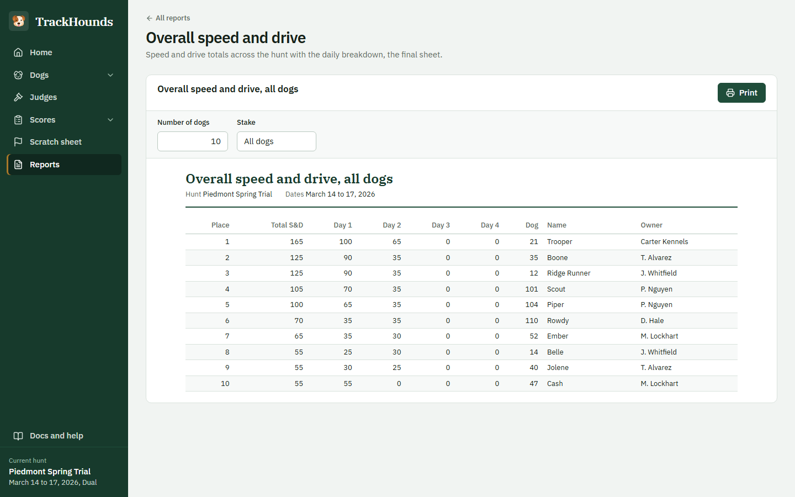

# trackhounds

_By: Hunt Tynch_


---

## **_Tools and Technologies_**


---

## Score Tracking Software

TrackHounds is a modern scoring application designed to provide an alternative to outdated scoring software currently used in Master's Foxhunts. It allows users to efficiently manage hunts, track scores, and generate reports.

**TrackHounds 3 is a self-contained Windows desktop application.** Everything (the application, its Java runtime and the SQLite database) is inside the installer. It does not need Docker, an internet connection, or any other software.

> Migrating from TrackHounds 2 (the Docker/Electron version)? See [Upgrading from version 2](#upgrading-from-version-2).


---

## Needed Resources

- [**TrackHounds Installer**](https://github.com/hctynch/trackhounds/releases/latest) (`TrackHounds-<version>.exe` under `Assets`)
  - Or the portable `TrackHounds-<version>-win-portable.zip` if you prefer not to install anything
  - Nothing else: no Docker, no Java, no internet connection

---

## Usage & Help

### Live Demo

- Email me at `tynchhunt@gmail.com` to arrange a demo of TrackHounds

### Issues, Bugs, and Feature Requests

To report issues or request features:

1. Go to the [Issues](https://github.com/hctynch/trackhounds/issues) tab.
2. Click `New Issue` in the top right.
3. Select the appropriate template (e.g., Feature Request, Bug Report).
4. Fill in the template and click `Create`.

---

## User's Guide

### Install

1. **Download the Installer**

   - Go to the [latest release](https://github.com/hctynch/trackhounds/releases).
   - Under `Assets` download `TrackHounds-<version>.exe`.

2. **Run the Installer**

   - Windows may show _"Windows protected your PC"_ because the installer is not code-signed. Click `More info` and then `Run anyway`.
   - TrackHounds installs for the current user (no administrator password needed) and adds shortcuts to the Desktop and Start menu.
   - Running a newer installer later upgrades TrackHounds in place. Your data is kept.

3. **Start TrackHounds**

   - Open TrackHounds from the shortcut. The application window opens and a TrackHounds icon appears in the system tray (next to the clock).
   - The window is shown with Microsoft Edge in "app mode" (no tabs or address bar). If Edge is not available the page opens in your default browser.

4. **Close TrackHounds**

   - Close the application window, or right-click the tray icon and choose `Quit TrackHounds`.
   - Data is saved as you work, so nothing is lost when closing.

### Where your data is

Everything TrackHounds stores lives in one folder:

```
%LOCALAPPDATA%\TrackHounds        (for example C:\Users\<you>\AppData\Local\TrackHounds)
├── trackhounds.db                the database (all hunts, dogs, judges, scores, scratches)
├── logs\trackhounds.log          log files, useful when reporting a problem
└── browser-profile\              private browser profile used for the application window
```

- **Backup**: close TrackHounds and copy `trackhounds.db` somewhere safe.
- **Restore**: close TrackHounds and copy the file back.
- **Start over**: close TrackHounds and delete (or rename) `trackhounds.db`; an empty database is created on the next start.
- The tray icon menu has an `Open data folder` shortcut. The `Docs` page inside the application also shows the folder.

### Upgrading from version 2

Version 2 stored its data inside a Docker volume; version 3 stores it in `trackhounds.db`. Data is **not** migrated automatically (each hunt normally starts from an empty database anyway). After installing version 3 you can uninstall Docker Desktop and the old TrackHounds 2 application.

---

### Troubleshooting

#### The window did not open

- Right-click the TrackHounds icon in the system tray and choose `Open TrackHounds`.
- Or open the address shown in the `About TrackHounds` tray dialog (normally `http://127.0.0.1:8080/`) in any browser.

#### TrackHounds does not start

- If TrackHounds is already running, starting it again just opens a new window on the running copy.
- Look at `logs\trackhounds.log` in the data folder and attach it to a bug report.
- Re-running the installer repairs the installation without touching your data.

### Application Overview

The green rail on the left is the navigation. It always shows which hunt is loaded, and `Docs and help` at the bottom
opens the in-app guide, including where this installation keeps its data.

#### Home

The dashboard for the current hunt: how many dogs and judges are registered, the stake and point interval, and the
overall and daily standings (speed and drive plus endurance). `Edit hunt` and `New hunt` live in the page header.
Creating a new hunt clears the current one.

#### Dogs

- **All dogs**: every registered dog with its stake, owner, sire, dam and points. Edit or remove a dog from the row;
  removing asks for confirmation.
- **Add dogs**: register several dogs at once. Arrow keys move between cells, and sire and dam suggest names already
  typed on the page. Dogs take their stake from the hunt's number ranges.


#### Judges

The judges of the hunt. Adding and editing happens in a small dialog; scores are recorded against the judge number.

#### Scores

- **Enter scores**: one cross at a time. Pick the day, enter the start time (the first cross of the day sets it), the
  cross time and the judge, then the dogs in crossing order. Points fill in from the first-dog points and the interval
  and can be changed per dog. Everything is reachable with the arrow keys and Enter.
- **View scores**: every cross recorded, filterable by day, dog or judge, with whether the score counted.


#### Scratch sheet

Dogs withdrawn from the hunt, with the time, the judge and the reason, and the form to record a new scratch.

#### Reports

Printable sheets, grouped into daily, whole-hunt and detail reports: daily and overall speed and drive, top dogs with
a chosen number of places and stake, all dogs on all days, scratches, and the scores of one dog or one judge. Each
report has a preview with its options and a `Print` button that uses the normal Windows print dialog.



---

## For Developers

### Prerequisites

- JDK 21 or newer (includes `jpackage`). Nothing else: Maven and Node are downloaded by the build.

### Project layout

```
trackhounds/   Spring Boot application: REST API, SQLite persistence, desktop launcher, packaging
frontend/      React user interface, built by Maven and bundled into the jar
docs/          Conversion plan, roadmap and design notes
.github/       CI (build + tests) and release (installer) workflows
```

### Build and test

```bash
cd trackhounds
./mvnw verify                 # builds the UI, bundles it, runs the tests against SQLite
./mvnw verify -DskipFrontend=true   # backend only (faster; jar has no UI)
```

### Run from source

```bash
cd trackhounds
./mvnw spring-boot:run                                   # desktop mode: tray icon + window
./mvnw spring-boot:run -Dspring-boot.run.arguments=--server   # server only, UI at http://localhost:8080
```

Useful switches (command line `--name=value`, system property `-Dname=value`, or environment variable):

| Setting                       | Environment variable         | Default                     |
| ----------------------------- | ---------------------------- | --------------------------- |
| `trackhounds.data-dir`        | `TRACKHOUNDS_DATA_DIR`       | `%LOCALAPPDATA%\TrackHounds` |
| `trackhounds.port`            | `TRACKHOUNDS_PORT`           | `8080`, else any free port  |
| `trackhounds.desktop.enabled` | `TRACKHOUNDS_DESKTOP_ENABLED` | `true`                     |

### Package the desktop application

```bash
cd trackhounds
./mvnw package -DskipTests -Papp-image               # target/dist/TrackHounds/TrackHounds.exe (portable)
./mvnw package -DskipTests -Papp-image,win-installer # + target/dist/TrackHounds-<version>.exe (needs WiX 3.x)
```

The `win-installer` profile needs the [WiX Toolset 3.x](https://github.com/wixtoolset/wix3/releases) on the `PATH`
(`candle.exe`/`light.exe`); GitHub's `windows-latest` runners have it preinstalled.

### Release

Push a tag `vX.Y.Z`. The [release workflow](.github/workflows/release.yml) builds the installer and the portable zip on
Windows and attaches them to a GitHub release.

### Roadmap

See [docs/CONVERSION_PLAN.md](docs/CONVERSION_PLAN.md) for the design decisions behind version 3 and the planned iterations.
