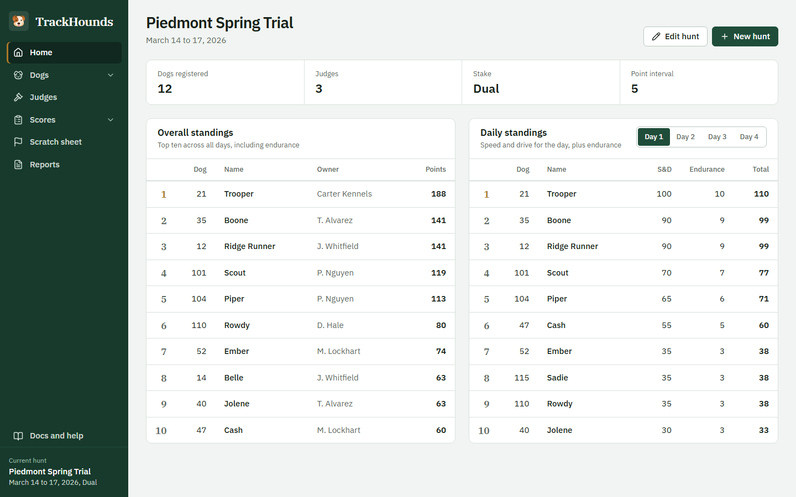
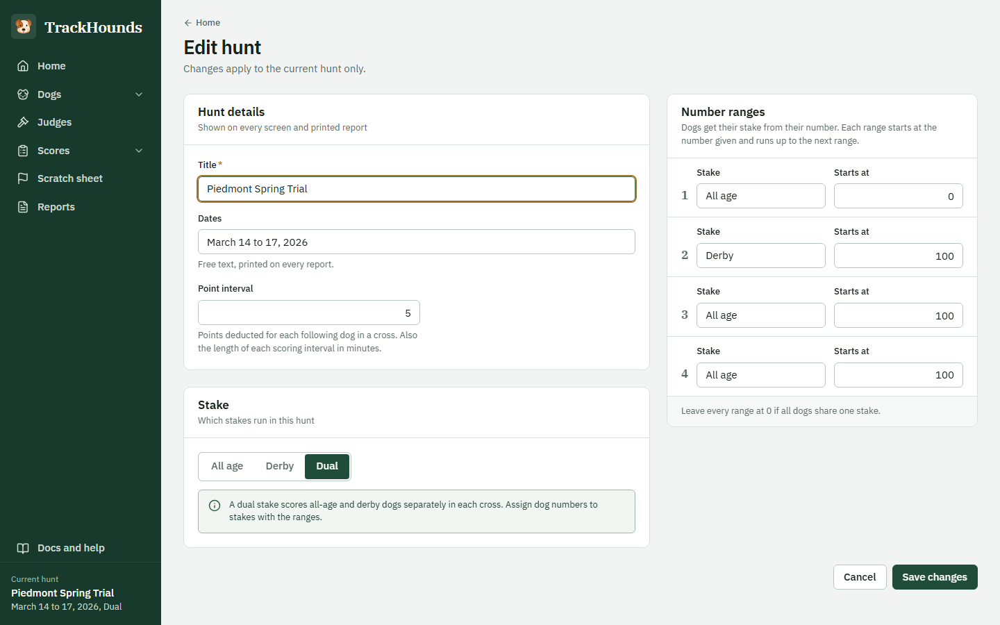
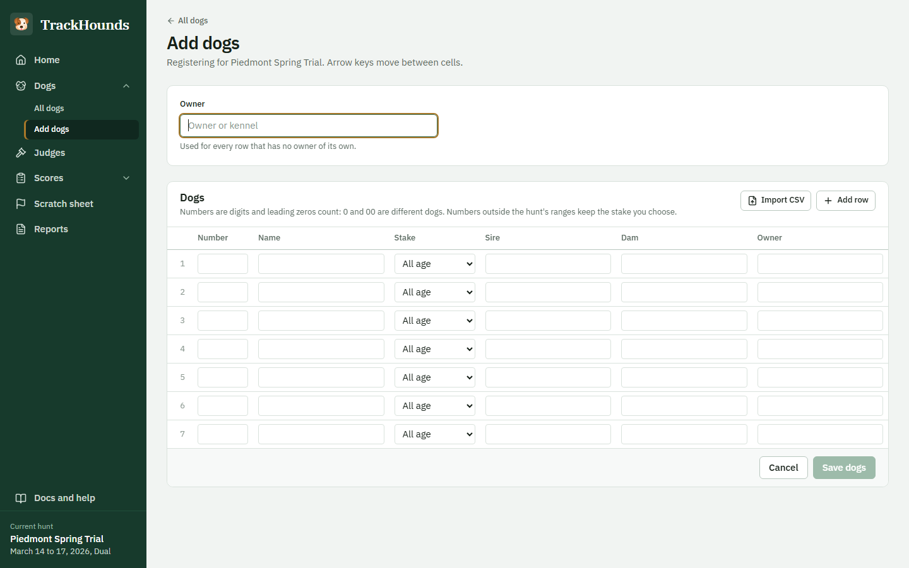
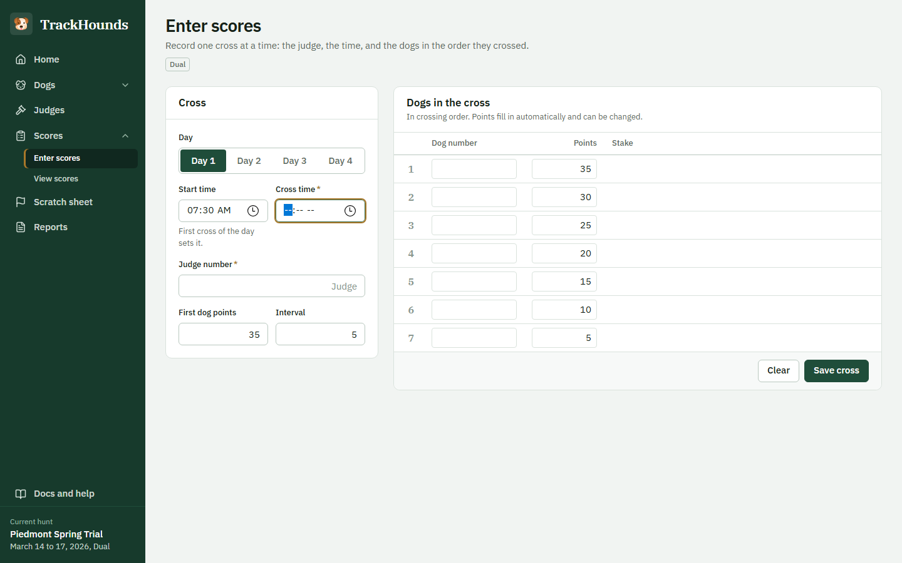
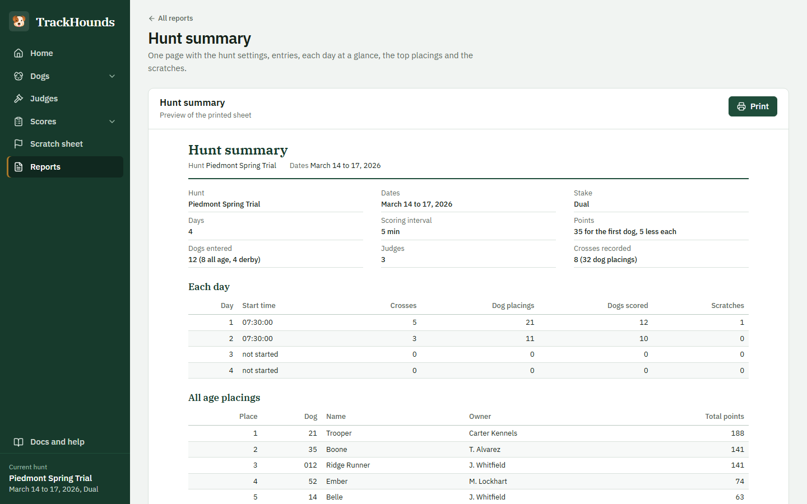

# TrackHounds quick start

Everything you do at a hunt, in order. The same steps are on the **Docs and help** page inside
TrackHounds, and the Home page shows a checklist until the hunt is set up.

## Install and open

1. Download `TrackHounds-<version>.exe` from the
   [latest release](https://github.com/hctynch/trackhounds/releases/latest) and run it. If Windows
   warns that the publisher is unknown, choose **More info**, then **Run anyway**.
2. Open TrackHounds from the Desktop or Start menu shortcut. The window opens and a tray icon appears
   next to the clock. Nothing else is needed: no internet, no Docker, no Java to install.
3. Close the window to quit. Everything is saved as you work.

## Before the hunt

### 1. Create the hunt

Home → **Create a hunt**.

| Setting          | What it means                                                                                 |
| ---------------- | --------------------------------------------------------------------------------------------- |
| Title, dates     | Printed at the top of every report.                                                           |
| Days             | 1 to 4. Reports and the score entry only offer these days.                                    |
| Scoring interval | Minutes. Counted from the day's start time, only a dog's highest cross per interval is scored. |
| First-dog points | Points for the first dog in a cross (normally 35).                                            |
| Point step       | How many points fewer each following dog gets (normally 5).                                   |
| Stake            | All age, derby, or dual. A dual hunt scores the two stakes as separate crosses.                |
| Number ranges    | Dual hunts only: which dog numbers are all age and which are derby.                           |

### 2. Add the judges

**Judges** → **Add judge**. Each judge has a number; scores are recorded against it. The member PIN
is only a reference and is never checked.

### 3. Register the dogs

**Dogs → Add dogs**. Two ways:

- **Type the rows.** Arrow keys move between cells. Sire and dam suggest names already typed on the
  page, so a litter is quick to enter. The owner at the top applies to every row without one.
- **Import CSV.** Click **Import CSV** and pick a file with the columns
  `number, name, stake, sire, dam, owner` (a header row is optional, extra columns are ignored, stake may
  be left blank to use the hunt's number ranges). **Download template** on the same page saves an example
  file to start from. Rows that cannot be read are listed and skipped; the rest land in the table for
  checking before you save.

Dog numbers are digits only and leading zeros count: **0 and 00 are two different dogs**.

## Each day

### 4. Enter the first cross and set the start time

**Scores → Enter scores**. Pick the day and type the day's start time with the first cross; every
later cross that day is scored in intervals from it. If the start time turns out to be wrong, use
**Change start time**: the day's crosses are re-sorted and every dog's points are recalculated.

### 5. Enter each cross

Cross time, judge, then the dogs in crossing order. Points fill in from the hunt's first-dog points
and point step and can be overridden per dog. Enter moves through the rows and saves; the judge number
is kept for the next cross, and the day's last three crosses are listed under the form.

- A dog that is not registered stops the save with a message: **register it on the spot** or **skip
  it**. The other dogs keep their places.
- A cross time earlier than that judge's last cross shows a warning, in case the time was mistyped.

### 6. Scratch withdrawn dogs

**Scratch sheet** → fill in the dog number, day, time, judge and reason (pick one from the list or
**Other** with a note). A scratched dog keeps its points, stays in the standings and is marked
**(scratched)** on every report. Removing the scratch un-marks the dog.

### 7. End of the day

**Reports → Daily speed and drive** for the day, then **Print**. Home shows the daily and overall
standings as scores come in. In a dual hunt, switch Home between **Both stakes**, **All age** and
**Derby**: each stake is placed on its own, and with both listed together every dog carries its stake tag.

## End of the hunt

### 8. Print the final sheets

| Report                    | What it is                                                                             |
| ------------------------- | -------------------------------------------------------------------------------------- |
| Hunt summary              | One page: settings, entries, each day at a glance, top placings per stake, scratches.  |
| Overall speed and drive   | The final standings with the daily breakdown, for all dogs or one stake.               |
| All dogs, all days        | Speed and drive and endurance for every dog on every day.                              |
| Scratches                 | Every withdrawn dog with the judge and reason.                                         |
| Judge summary             | Crosses and dogs scored by each judge per day, and the scratches they recorded.        |
| Scores for one dog/judge  | Every cross, and whether it counted, for checking a query.                             |
| Custom reports            | Your own sheets from the report builder (**New report**, or **Customise** on any sheet). |

### 9. Keep a copy of the data

**Backups** → **Save a backup** writes a copy to the backups folder inside the data folder; **Download a
copy** saves one to a USB stick or another folder. Do this at the end of every day. A backup can be
restored from the same page, and a safety copy of the current data is taken before any restore.

### 10. Start the next hunt

Home → **New hunt**. Leave **Save this hunt to past hunts first** checked: the finished hunt is kept
on the Backups page under past hunts, where it can be opened again later. The new hunt then starts
empty (dogs, judges, scores and scratches).

## Fixing mistakes

| Mistake                | What to do                                                                                              |
| ---------------------- | ------------------------------------------------------------------------------------------------------- |
| A wrong score          | **View scores** → delete the line, then enter the cross again. Points are recalculated for every dog.   |
| A wrong start time     | **Enter scores → Change start time**. The day's crosses are re-sorted into intervals from the new time. |
| A wrong dog number     | **All dogs** → edit the dog → change the number. Its scores and scratches move with it.                 |
| Scratched by mistake   | **Scratch sheet** → remove the scratch.                                                                 |
| Wrong hunt settings    | Home → **Edit hunt**. Changing number ranges does not change the stake of dogs already registered.      |
| Wrong dog details      | **All dogs** → edit the dog (name, stake, owner, sire, dam).                                            |
| Something went badly   | **Backups** → restore the last backup, or the safety copy taken before a restore.                       |
| Need last year's hunt  | **Backups** → past hunts → **Open**. The current hunt is saved to past hunts first.                     |

## How points are worked out

- Each cross awards the first dog the first-dog points and every following dog the point step less.
- Within each scoring interval from the day's start time, only a dog's highest cross counts. The
  **Scores for one dog** report shows every cross and whether it counted.
- **Speed and drive** for a day is the sum of the counted crosses. **Endurance** adds ten percent of it
  per day number (day 1 adds 10 %, day 2 adds 20 %, and so on, rounded down).
- Ties are broken by the later last counted cross.
- In a dual stake hunt, the all age and derby dogs in one cross are scored as two separate crosses.
